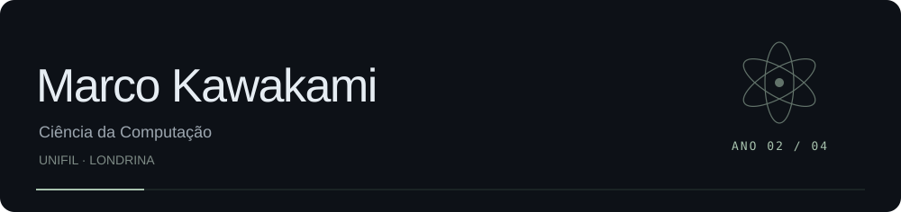

 

 
 

Estudante de **Ciência da Computação** na **UniFil Londrina**. 
Atualmente no 2º ano de um curso de 4 anos.

 
 

INTERESSES

**Inteligência Artificial** &nbsp; / &nbsp; **Machine Learning** &nbsp; / &nbsp; **Jogos Digitais**

Tenho interesse em aprender como a inteligência artificial e o aprendizado de máquina 
podem ser aplicados em projetos, além de explorar a criação de jogos digitais.

 

LINGUAGENS E MARCAÇÃO

Conhecimentos em **Java**, **HTML**, **Portugol** e **JavaScript**.

 

APRENDENDO ATUALMENTE

Aprofundando lógica de programação, orientação a objetos e banco de dados. 
Explorando o desenvolvimento de jogos com Godot e aplicando os estudos em projetos.

 

OBJETIVOS

Fortalecer minha base em desenvolvimento de software e transformar ideias em projetos. 
Quero aprofundar meus conhecimentos em IA e Machine Learning 
e explorar suas possibilidades no desenvolvimento de jogos digitais.

 
 

PROJETOS EM DESTAQUE

**[Atividade SOLID · Sistema de delivery](https://github.com/odeioluvadepedreiro/atividade-solid)** 
Sistema de delivery em Java com aplicação dos cinco princípios SOLID. 
Pedidos, pagamentos e notificações simulados no console · Java 17+

 

**[Projeto Godot](https://github.com/odeioluvadepedreiro/projeto-godot)** 
Projeto desenvolvido em Godot, ligado ao meu interesse por jogos digitais. 
Godot · Desenvolvimento de jogos

 

[Extensão Godot — em preparação](https://github.com/odeioluvadepedreiro/Extens-o-Godot) 
[Todos os projetos ↗](https://github.com/odeioluvadepedreiro?tab=repositories)

 
 

CONTATO

[marco.kawa.contato@gmail.com](mailto:marco.kawa.contato@gmail.com)

 

