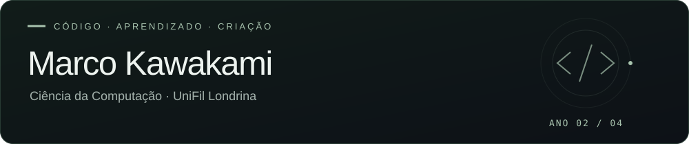

 
 

 
 

INTELIGÊNCIA ARTIFICIAL &nbsp; · &nbsp; MACHINE LEARNING &nbsp; · &nbsp; JOGOS DIGITAIS

 

[Sobre mim](#sobre-mim) &nbsp; / &nbsp; [Tecnologias](#tecnologias) &nbsp; / &nbsp; [Projetos](#projetos) &nbsp; / &nbsp; [Contato](#contato)

---

### Sobre mim

Sou estudante de **Ciência da Computação na UniFil Londrina**, atualmente no **2º ano de um curso de 4 anos**. Aprendo na prática com atividades da faculdade e projetos pessoais.

Tenho interesse em **Inteligência Artificial**, **Machine Learning** e **Jogos Digitais**. Quero transformar ideias em projetos e explorar como essas áreas podem se conectar.

 

### Tecnologias

 
 

<code>Java</code> &nbsp; <code>HTML</code> &nbsp; <code>JavaScript</code> &nbsp; <code>Portugol</code>

 
 

EM APRENDIZADO

Lógica de programação &nbsp; · &nbsp; Orientação a objetos &nbsp; · &nbsp; Banco de dados 
Desenvolvimento de jogos com **Godot**

 

### Projetos

<table>
<tr>
<td width="50%" valign="top">

01 &nbsp; / &nbsp; JAVA · SOLID

<h3><a href="https://github.com/odeioluvadepedreiro/atividade-solid">Sistema de delivery ↗︎</a></h3>

Sistema em Java com aplicação dos cinco princípios SOLID.

Pedidos, pagamentos e notificações simulados no console.

<code>Java 17+</code> &nbsp; <code>Orientação a objetos</code>

</td>
<td width="50%" valign="top">

02 &nbsp; / &nbsp; JOGOS DIGITAIS

<h3><a href="https://github.com/odeioluvadepedreiro/projeto-godot">Projeto Godot ↗︎</a></h3>

Projeto desenvolvido em Godot, ligado ao meu interesse pela criação de jogos digitais.

<code>Godot</code> &nbsp; <code>Jogos</code>

</td>
</tr>
</table>

[Todos os projetos ↗︎](https://github.com/odeioluvadepedreiro?tab=repositories) &nbsp; · &nbsp; [Extensão Godot — em preparação](https://github.com/odeioluvadepedreiro/Extens-o-Godot)

 

### Contato

VAMOS CONVERSAR SOBRE TECNOLOGIA E PROJETOS

 
 

**[marco.kawa.contato@gmail.com](mailto:marco.kawa.contato@gmail.com)**

 

